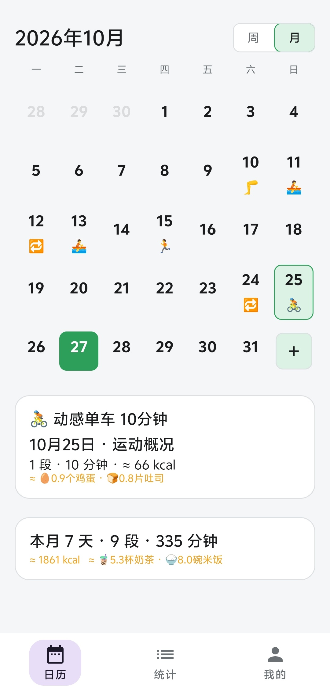
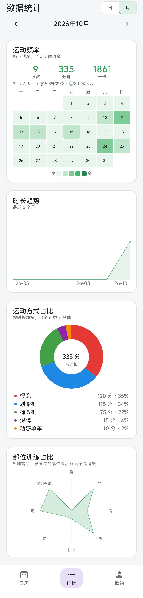
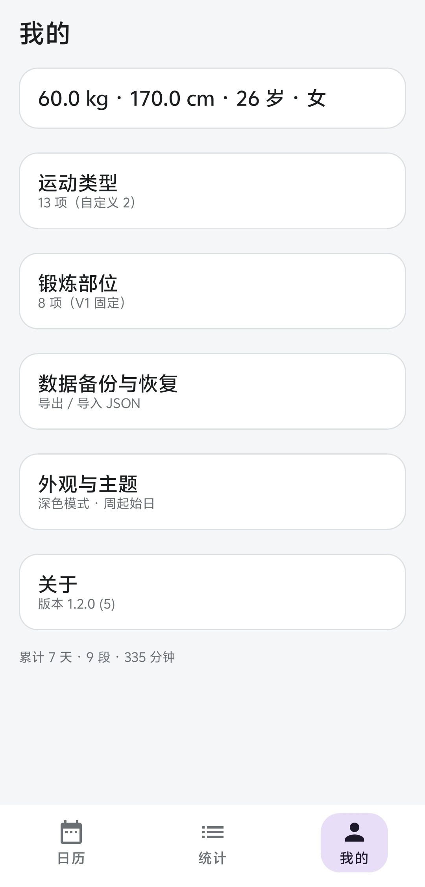

# 轻体记

轻体记是一款以日历为主页的 Android 健身记录工具。打开就能记，数据只留在本机。没有账号、没有广告、没有社交，也不申请网络权限。

当前版本 **1.2.0**（`versionCode` 5），包名 `com.fitrecord.app`，最低支持 Android 8.0（API 26）。

## 页面预览

底部三个入口：日历、统计、我的。

| 日历（主页） | 数据统计 | 我的 |
| :---: | :---: | :---: |
|  |  |  |
| 按周/月查看训练，练过的日期标色 | 频率、趋势、占比、雷达图多维统计 | 体重、外观主题、备份与恢复 |

## 功能

底部三个入口：日历、统计、我的。

### 日历

- 按周或按月查看训练情况，左右滑动切换月份，离开本月后可以一键回到今天。
- 练过的日期会标出运动类型对应的颜色；点某一天进入当日记录。
- 周起始日可在「我的 → 外观与主题」里选周一或周日，日历和周统计一起跟着变。

### 当日记录

一天可以记多段训练。每段包含：

- 运动类型
- 时长（分钟），力量类改为「组数 × 每组个数」
- 锻炼部位（可多选）
- 备注（重量、感受等）

当天还可以写一条总备注。段数由当天的训练条数得出，例如早跑加晚骑算两段。

力量类（深蹲、俯卧撑、哑铃，以及按组数记录的自定义类型）按每组 3 分钟折算时长，用于总时长和卡路里。界面上仍显示「5 组 × 20 个」这种组数。

### 运动类型

内置类型：划船机、椭圆机、动感单车、跑步机、自由力量、快走、深蹲、俯卧撑、哑铃。瑜伽和游泳保留在类型库中，选择器默认不列出。

也可以自己添加类型：名称不超过 10 个字，MET 取值 0.5–20，可指定颜色和默认部位。应用内提供常见运动的 MET 参考表，点一下即可填入。已被记录引用的类型不能直接删除，以免历史记录失去分类。

锻炼部位固定为八项：胸、背、肩、手臂、核心、臀、腿、全身有氧。

### 数据统计

统计页可在周、月之间切换，并前后翻页。页首汇总本周期的训练段数、总分钟和消耗千卡。

| 图表 | 内容 |
| --- | --- |
| 运动频率 | 周视图为每日段数柱状图，月视图为日历热力图（颜色越深练得越多） |
| 时长趋势 | 周统计看最近 8 周，月统计看最近 6 个月 |
| 运动方式占比 | 按时长加权的环形图，最多 6 类，其余归入「其他」 |
| 部位训练占比 | 八个部位的雷达图，没练过的部位显示为 0 |

点频率图里的某一天，会打开那天的记录。有体重时，汇总行还会给出食物等价，例如相当于多少碗米饭、多少根香蕉。

### 卡路里与食物等价

保存记录时按下面的公式计算并写入本地，之后改体重不会改写已经算好的历史消耗：

```text
千卡 = MET × 体重(kg) × 时长(小时)
```

体重是必填项。没填体重时，对应记录不计算消耗，统计里会标明有多少条尚未计算。身高、年龄、性别可以留空。

食物库是固定的十项，用来把消耗换算成日常食物：米饭、香蕉、苹果、可乐、巧克力、鸡腿、鸡蛋、吐司、牛奶、奶茶。

### 外观

主题可选跟随系统、浅色或深色。

### 备份与恢复

所有训练、身体参数、自定义类型和备注都存在本机 SQLite 里。

- **导出 JSON**：完整备份，适合换机或重装后恢复。
- **导出 CSV**：只导出训练记录表，方便用表格软件查看。
- **导入**：先预览将新增、覆盖、跳过的条数。重复记录默认跳过；选择覆盖时需要再次确认。

数据库升级失败时，应用会进入只读，避免继续写入损坏数据。数据库文件无法打开时，可以重建空库，或重建后从 JSON 备份导入。

## 隐私

清单文件不声明网络权限。记录、统计和备份文件都由用户自己保管，导出和导入走系统文件选择器，应用不上传任何内容。

## 构建

工程在 `android/` 目录，使用 Kotlin、Jetpack Compose 和 Room。详细环境、签名和常用命令见 [编译工具.md](编译工具.md)。

在 `android` 目录下：

```powershell
. .\env.ps1
.\gradlew.bat :app:assembleRelease
```

发布包输出到 `android/app/build/outputs/apk/release/`。没有配置发布密钥时会回退到调试签名，这种包只能自测，不能用来覆盖升级。安装与备份恢复步骤见 [docs/plan/安装说明.md](docs/plan/安装说明.md)。
